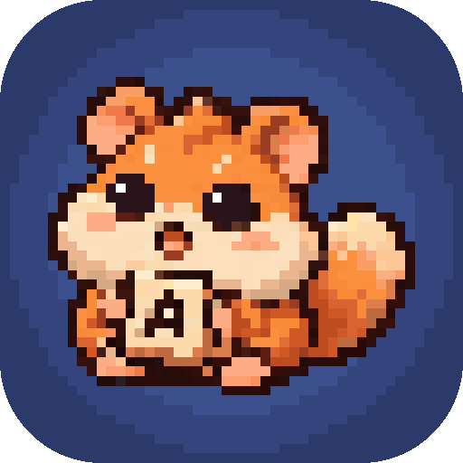
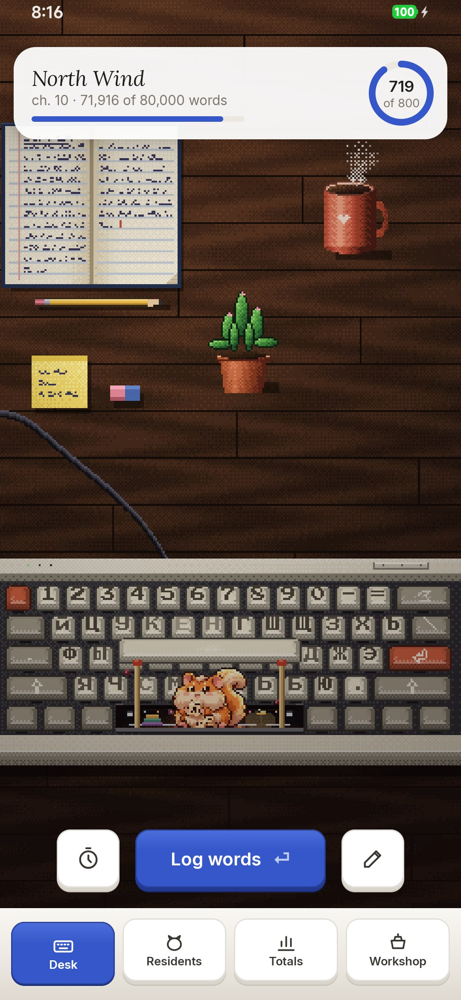
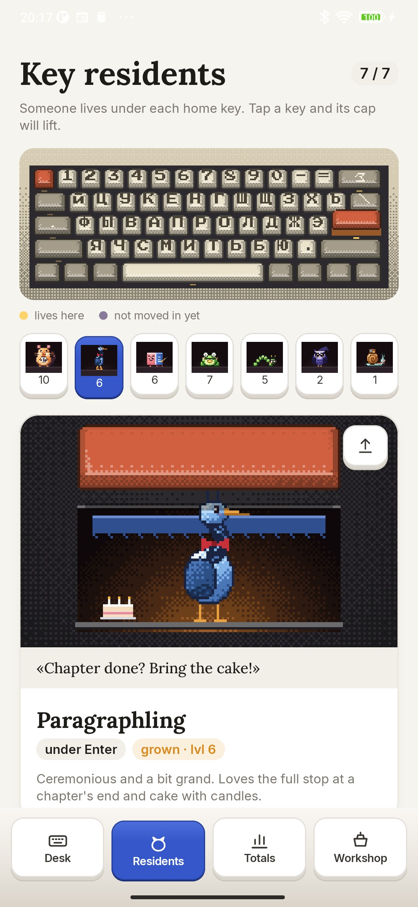
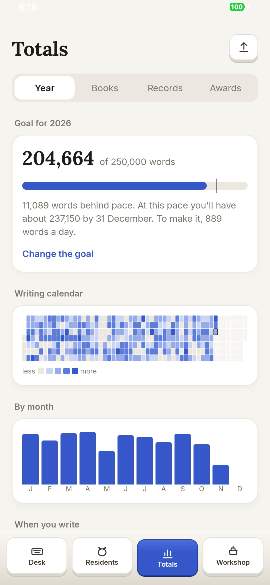
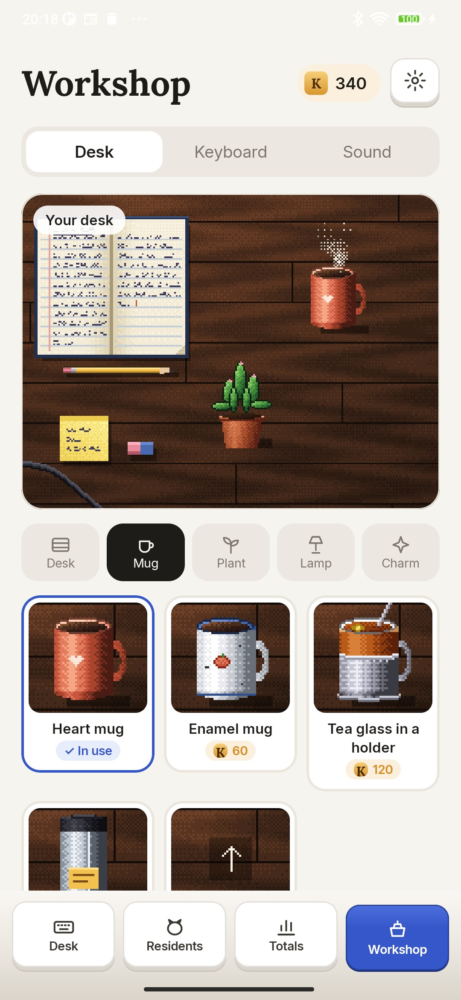

<div align="center">



# Keyling

### A keyboard where someone lives

*Writing a novel, stories or a thesis? Log what you write, and the residents of your keyboard eat the words, grow and furnish your desk. A year goal, streaks, records and cards to share. Free, no ads, no account, works offline.*

[](https://github.com/bigdevwhale/keyling/actions/workflows/android.yml)
[](https://github.com/bigdevwhale/keyling/releases/latest)


[](LICENSE)

**English** · [Русский](README.ru.md) · [Website](https://bigdevwhale.github.io/stillcraft/apps/keyling/) · [Changelog](CHANGELOG.md)

   

**[Download APK](https://github.com/bigdevwhale/keyling/releases/latest/download/Keyling.apk)** · Android 9+

</div>

---

## The desk

The home screen is your desk: a notebook, a steaming mug, a plant and a mechanical keyboard. The space bar is propped up on two matchsticks, and in the warm nook under it, among fairy lights, lives Spacelet.

Log the words you've added and letters rain onto the keys; Spacelet gathers them up and munches. You can also type the total from Word or Google Docs and Keyling works out what's new. Stroke the resident and it says something. Typo bugs crawl between the keys – "its/it's", a stray comma, "the the" – catch them with a finger and they go in the jar.

A week without writing and dust settles on the keyboard while the resident sleeps. Fifty words blow it away.

## The key residents

Seven different creatures live under seven keys, and each feeds on its own part of the writing work:

- **Spacelet** (space) – a dormouse with cheeks full of letters. Eats any words.
- **Paragraphling** (Enter) – a heron in a bow tie. Comes to a feast when you mark a finished chapter.
- **Erasel** (Backspace) – an eraser in a paper sleeve. Eats editing.
- **Shouter** (Caps Lock) – a frog that sings while you sprint. Eats sprints.
- **Indent** (Tab) – an inchworm in glasses. Loves a book plan.
- **Night Owl** (Shift) – an owl in a night cap. Eats nights you write after midnight.
- **Escapee** (Esc) – a snail with a suitcase. Comes on an honest day off.

On the Residents tab, tap a home key: the cap lifts and you see the resident at home, with what it eats, how far it is to the next level and a button to feed it right now. Residents grow with their levels: baby, youngster, grown, ancient.

One resident lives on the desk, and while it's there its ability works: more coins for words, chapters, editing, sprints or night words, a gentler daily goal, or a spare day that keeps your streak.

## Sprints and the ghost

Tap the clock and pick 10, 15, 25 or 45 minutes. Write wherever you like; Keyling keeps time. The ghost is your best sprint – at the end you see whether you beat it.

## Totals

- **Year.** A year goal with a pace marker, a forecast for 31 December, a writing calendar, months, hours and weekdays.
- **Books.** Words, author's sheets and pages, chapters, days of work, hours of editing and a forecast finish, measured against the classics.
- **Records.** Best day, week and month, longest streak, best sprint, latest word and your road of milestones.
- **Awards.** Nearly forty medals, a few of them secret.

Share any of it: you see the card first, then send it anywhere or save it. There are cards for the year, month, week, book, streak, calendar and records, plus a resident and an award.

## The workshop

Words, daily goals, chapters and awards earn coins. Spend them on the desk – dark walnut or green baize, an enamel mug or a tea glass in a holder, a monstera, a banker's lamp, a candle, a globe, a sleeping cat – trying each thing on first. Make your own mug from any photo. Hold a thing on the desk to move it.

Keycap sets change the keyboard, and the caps wear like real ones. Three real recorded switches – blue, brown and red – click on every key in the app.

## More

- **Light and dark themes**, English and Russian, in settings.
- **Words or characters**, your own daily goal, several books, words written before Keyling.
- **Move your progress.** Everything goes into one file you can open on another phone; Android backup keeps a copy too.
- **Offline.** No network access; everything stays on the phone.

## Build

You need JDK 17+ (Android Studio's JBR works) and the Android SDK.

```bash
git clone https://github.com/bigdevwhale/keyling.git
cd keyling
./gradlew testDebugUnitTest assembleDebug          # app.keyling.dev
./gradlew assembleDebug -Pdemo                     # app.keyling.demo: a year of writing, three books, every resident
./gradlew testDebugUnitTest -Prender               # residents, share cards and the icon in app/build/art
```

Kotlin, Jetpack Compose, Room, DataStore. All the pixel art is drawn in code.

## Feedback

Workshop → settings has "Report a bug" and "Suggest an idea", which open the StillCraft bot on Telegram.

## License

MIT. Fonts Press Start 2P (CodeMan38), Lora (Cyreal) and Inter (Rasmus Andersson), SIL Open Font License. Key sounds from [kbsim](https://github.com/tplai/kbsim) (MIT). Keyling is part of [StillCraft](https://bigdevwhale.github.io/stillcraft/), a shelf of small free apps.
