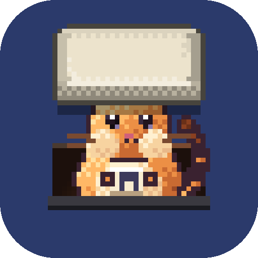
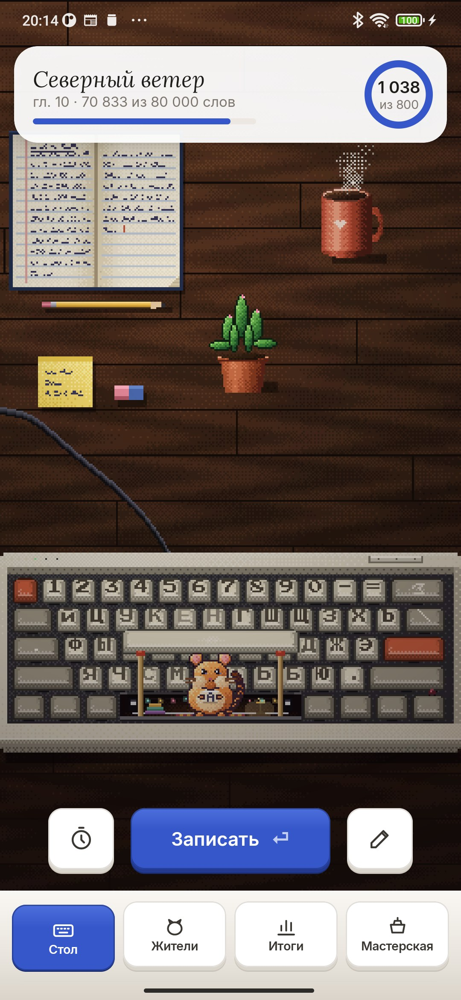
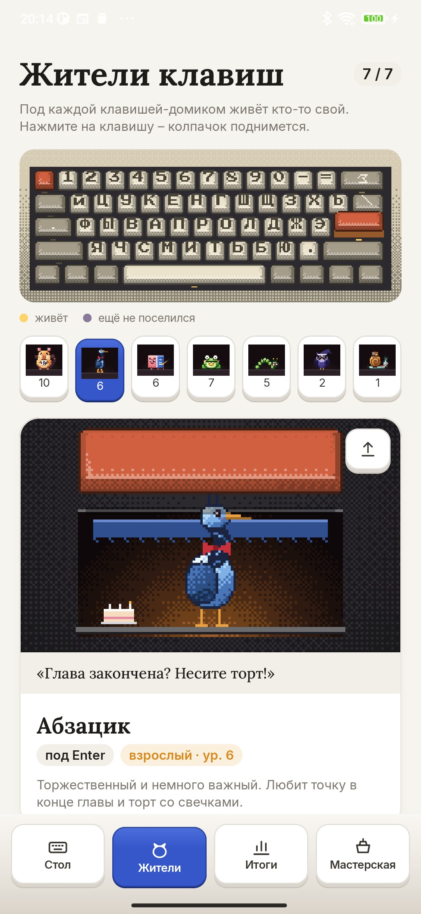
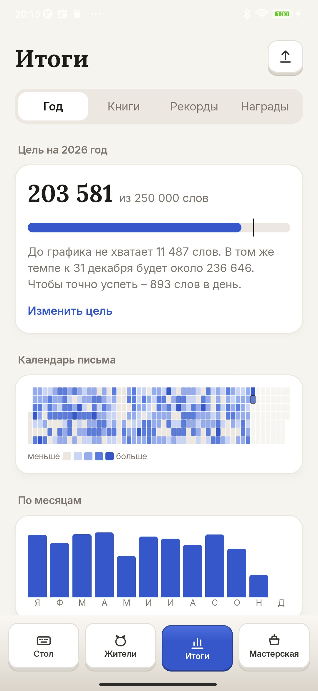
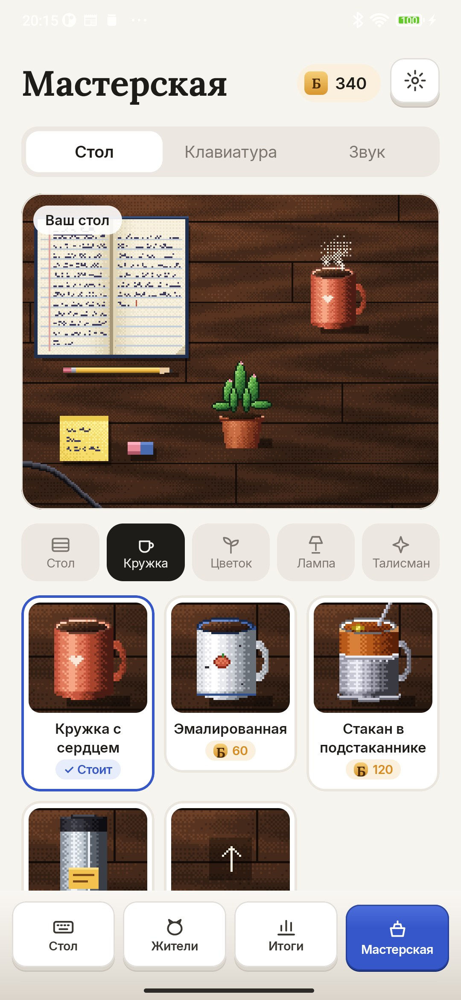

<div align="center">



# Клавишка

### Под клавишами живут те, кто ест ваши слова

*Пишете книгу, рассказы или диплом? Записывайте, сколько написали, и маленькие жители клавиатуры будут есть ваши слова, расти и обживать письменный стол. Цель на год, серии, рекорды и открытки со статистикой. Бесплатно, без рекламы и регистрации, работает без интернета.*

[](https://github.com/bigdevwhale/keyling/actions/workflows/android.yml)
[](https://github.com/bigdevwhale/keyling/releases/latest)


[](LICENSE)

[English](README.md) · **Русский** · [Сайт](https://bigdevwhale.github.io/stillcraft/apps/keyling/) · [Изменения](CHANGELOG.md)

   

**[Скачать APK](https://github.com/bigdevwhale/keyling/releases/latest/download/Keyling.apk)** · Android 9+

</div>

---

## Письменный стол

На главном экране – ваш стол: блокнот, кружка с паром, цветок и механическая клавиатура. Пробел приподнят на двух спичках, а под ним в тёплом уголке с гирляндой живёт Пробельчик.

Записали, сколько слов прибавилось, – и буквы сыплются на клавиши, а Пробельчик собирает их и жуёт. Можно ввести не прибавку, а итог из счётчика Word или Google Docs: Клавишка сама посчитает, сколько нового. Погладьте жителя – он что-нибудь скажет. Между клавишами бегают бесы-опечатки: «тся/ться», лишняя запятая, «было было». Поймайте их пальцем, они пойдут в банку.

Если неделю ничего не писать, клавиатуру затянет пылью, а житель уснёт. Хватит пятидесяти слов, чтобы её сдуть.

## Жители клавиш

Под семью клавишами живут разные существа, и каждый питается своей частью писательской работы:

- **Пробельчик** (пробел) – соня с полными щеками букв. Ест любые слова.
- **Абзацик** (Enter) – цапля в бабочке. Приходит на праздничный ужин, когда вы отмечаете законченную главу.
- **Затирыш** (Backspace) – ластик в бумажной обёртке. Ест правку: у редактуры наконец есть свой зверь.
- **Горлан** (Caps Lock) – лягушка, которая поёт, когда вы пишете на скорость. Ест спринты.
- **Отступ** (Tab) – гусеница в очках. Любит план книги.
- **Полуночник** (Shift) – сова в ночном колпаке. Ест ночи, когда вы пишете после полуночи.
- **Беглец** (Esc) – улитка с чемоданом. Приходит в честный выходной.

На вкладке «Жители» нажмите на клавишу-домик: колпачок поднимется, и вы увидите жителя в его норке. Там же написано, чем он питается, сколько осталось до следующего уровня и как накормить его прямо сейчас. С уровнями жители подрастают: малыш, подросток, взрослый, древний.

На столе живёт один житель, и пока он там, работает его способность. Пробельчик даёт больше буквиц за слова, Абзацик щедрее платит за главу, Затирыш вдвое за правку, Горлан за спринты, Полуночник за ночные слова, Отступ засчитывает норму уже на 90%, а Беглец бережёт серию, если вы пропустили день.

## Спринты и призрак

Нажмите на часы и выберите 10, 15, 25 или 45 минут. Пишите где удобно, Клавишка засечёт время. Призрак – это ваш лучший спринт: в конце видно, обогнали вы его или нет.

## Итоги

- **Год.** Цель на год с отметкой «по графику», прогноз на 31 декабря, календарь письма, месяцы, часы и дни недели.
- **Книги.** Сколько написано, авторские листы и страницы, главы, дни в работе, часы правки и прогноз финиша. Сравнение с классикой: «уже длиннее, чем „Собачье сердце“».
- **Рекорды.** Лучший день, неделя и месяц, самая длинная серия, лучший спринт, самое позднее слово и лента вех.
- **Награды.** Почти сорок медалей: за тысячу слов в день, месяц без пропусков, первую дописанную книгу, сто часов правки, пойманных бесов и несколько секретных.

Любым итогом можно поделиться: сначала видно открытку, потом её можно отправить куда угодно или сохранить в галерею. Есть открытки за год, месяц и неделю, по книге, серии, календарю и рекордам, а ещё с жителем и с наградой.

## Мастерская

За слова, норму, главы и награды начисляются буквицы. На них стол обставляется по вкусу: тёмный орех или зелёное сукно, эмалированная кружка или стакан в подстаканнике, монстера, банкирская лампа, свеча, глобус, спящий кот. Перед покупкой вещь можно примерить. Свою кружку можно сделать из любого фото. Вещи на столе передвигаются: удерживайте и тащите.

Наборы колпачков меняют клавиатуру. Колпачки со временем стираются, как настоящие: чаще всего О, Е, А и пробел. Есть записи трёх настоящих переключателей – синих, коричневых и красных, – и каждая клавиша в приложении щёлкает выбранным.

## Ещё

- **Светлая и тёмная тема**, русский и английский язык – в настройках.
- **Слова или знаки с пробелами**, своя дневная норма, несколько книг, слова, написанные до Клавишки.
- **Перенос прогресса.** Всё сохраняется в один файл, который можно открыть на другом телефоне. Копия уходит и в резервную копию Android.
- **Без интернета.** У приложения нет доступа в сеть, всё хранится только на телефоне.

## Сборка

Нужны JDK 17+ (подойдёт JBR из Android Studio) и Android SDK.

```bash
git clone https://github.com/bigdevwhale/keyling.git
cd keyling
./gradlew testDebugUnitTest assembleDebug          # app.keyling.dev
./gradlew assembleDebug -Pdemo                     # app.keyling.demo: год письма, три книги, все жители
./gradlew testDebugUnitTest -Prender               # жители, открытки и иконка в app/build/art
```

Kotlin, Jetpack Compose, Room, DataStore. Пиксельная графика рисуется кодом, без картинок.

## Обратная связь

В Мастерской → настройки есть кнопки «Сообщить об ошибке» и «Предложить идею», они ведут к боту StillCraft в Telegram.

## Лицензия

MIT. Шрифты Press Start 2P (CodeMan38), Lora (Cyreal) и Inter (Rasmus Andersson), SIL Open Font License. Звуки клавиш – из [kbsim](https://github.com/tplai/kbsim) (MIT). Клавишка входит в [StillCraft](https://bigdevwhale.github.io/stillcraft/) – полку небольших бесплатных приложений.
